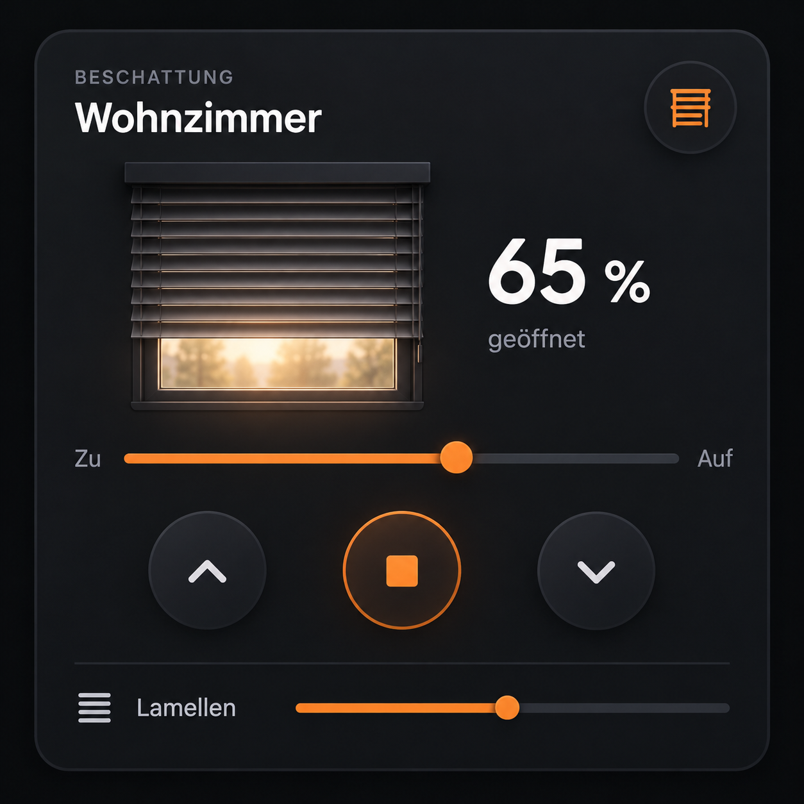
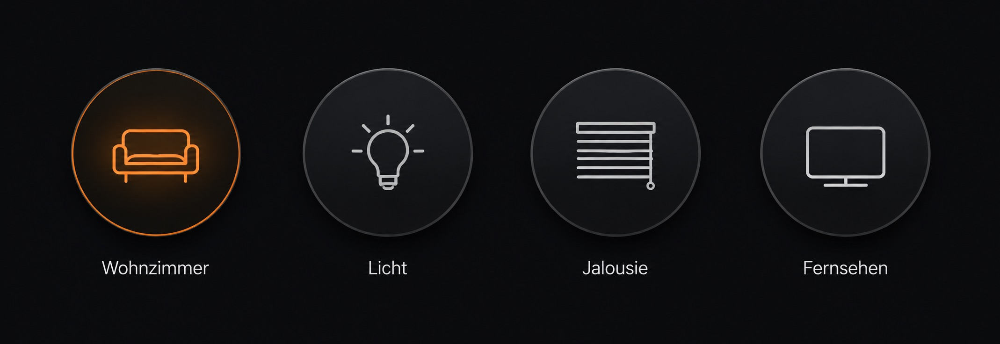

# Glass Cover Cards

Eine Sammlung responsiver Home-Assistant-Lovelace-Karten. Alle Kartenquellen liegen als TypeScript unter `cards/<kartenname>/`; `npm run build` prüft und kompiliert sie als Home-Assistant-kompatible Dateien nach `dist/`.

## Entwicklung

```sh
npm run build
npm test
```

Die TypeScript-Quellen liegen jeweils in `cards/<kartenname>/`. Die gebauten `dist/*.js`-Dateien werden mit versioniert, damit HACS sie direkt aus einer GitHub-Release installieren kann. Home-Assistant- und Editor-Typen stehen in `cards/glass-types.d.ts`.

## Karten

Die Texteingaben sind in allen Karteneditoren einheitlich als **Titel** und **Beschriftung** bezeichnet. Die YAML-Schlüssel bleiben aus Kompatibilitätsgründen kartenabhängig. Leere Texte werden ausgeblendet. Bei RGB bleibt die Beschriftung auch dann leer, wenn `name` nicht angegeben ist; bei anderen Karten bleiben deren bisherige Friendly-Name- oder Standardtexte erhalten. Sensorwerte, Zustandsanzeigen und Bedienelemente bleiben sichtbar.

```yaml
# Beispiel: Cover- oder RGB-Karte ohne Ueberschriften
title: ""
name: ""
```

### Glass Text

Eigenständige Panel-Kopfzeile mit Titel, Untertitel und optionalem Aktionsbutton. Größen von Überschrift und Button sind getrennt einstellbar.

```yaml
type: custom:glass-text-card
title: AKTIONEN
subtitle: Wohnzimmer
title_size: 5
show_action_button: true
action_entity: light.wohnzimmer
action_icon: mdi:sofa-outline
action: toggle
button_size: 5
```

### Glass Value

Visualisierung und Wert einer Entität nebeneinander. `visual_type: auto` erkennt Lüfter und Cover; alternativ stehen Lüfter, Jalousie, Icon und Bild zur Auswahl. `attribute` und `unit` erlauben eigene Werte.

```yaml
type: custom:glass-value-card
entity: fan.wohnzimmer
name: Lüftung
visual_type: fan
image_size: 5
value_size: 5
show_card_frame: false
```

```yaml
type: custom:glass-value-card
entity: sensor.temperatur
name: Temperatur
visual_type: image
image: /local/temperatur.png
attribute: temperature
unit: °C
```

### Glass Buttons

Einzelner runder Button. Mehrere Buttons werden in einem Home-Assistant-`horizontal-stack` nebeneinander angeordnet. `custom:glass-button-card` bleibt als bisherige Karten-ID unterstützt.

```yaml
type: horizontal-stack
cards:
  - type: custom:glass-buttons-card
    entity: light.wohnzimmer
    icon: mdi:sofa-outline
    show_card_frame: false
  - type: custom:glass-buttons-card
    entity: light.deckenlampe
    icon: mdi:lightbulb-outline
    show_card_frame: false
```

### Glass Splitter

Horizontaler Trenner zwischen Panel-Bereichen mit einstellbarer Stärke und Abstand.

```yaml
type: custom:glass-splitter-card
thickness: 1
spacing: 3
```

### Glass Cover Card



Steuert eine Jalousie mit Positionsregler, Hoch/Stopp/Runter, optionaler Lamellenleiste und Schnellwahl.

```yaml
type: custom:glass-cover-card
entity: cover.wohnzimmer
name: Wohnzimmer
title: Beschattung
show_tilt: true
show_position_slider: true
show_main_controls: true
show_close_tilt: true
# Kopfbutton ausblenden: show_action_button: false
show_preview: true
invert_position: false
button_size: 5
title_size: 5
preview_size: 5
# Optional: getrennte Entitaet fuer die Lamellenposition
# tilt_entity: cover.wohnzimmer_lamellen
```

### Glass Button Card



Jede Karte zeigt genau einen grossen runden Button. Fuer mehrere Bedienelemente fuegst du mehrere Glass Button Cards nebeneinander ins Dashboard ein. Entitaet, Icon, Text, Aktion, Groesse und Akzentfarbe sind pro Karte einstellbar.

```yaml
type: custom:glass-button-card
entity: light.wohnzimmer
name: Wohnzimmer
icon: mdi:sofa-outline
action: toggle
button_size: 5
show_name: true
color: orange
show_card_frame: true
```

Im visuellen Editor waehlst du Entitaet, Icon, Text, Aktion und Farbe aus. Dimmbare Lichter zeigen automatisch einen Helligkeitsring: Ziehen am Ring aendert die Helligkeit, ein Klick in der Mitte fuehrt weiterhin die gewaehlte Aktion aus. Bei 0 und 100 Prozent hat der Ring einen Anschlag: Weiterziehen springt nicht zum anderen Ende, die Gegenrichtung aendert die Helligkeit wieder. Beim Einschalten bewegt sich der Ring zur gemeldeten Helligkeit. Mit `show_brightness_slider: false` laesst sich der Ring ausblenden. Fuer mehrere Buttons legst du mehrere einzelne Karten im Dashboard-Raster nebeneinander an.

Fuer einen Button ohne Kartenrahmen, z. B. in einem `horizontal-stack`, setze `show_card_frame: false`. Die Textanzeige wird unabhaengig davon mit `show_name` gesteuert.

```yaml
type: horizontal-stack
cards:
  - type: custom:glass-button-card
    entity: light.wohnzimmer
    icon: mdi:sofa-outline
    show_card_frame: false
  - type: custom:glass-button-card
    entity: light.deckenlampe
    icon: mdi:lightbulb-outline
    show_card_frame: false
```

  ### Glass RGB Card

  Steuert ein farbfaehiges Licht ueber einen Farbkreis und einen Helligkeitsregler. Die Mitte schaltet das Licht ein oder aus; bis zu sechs Farb-Presets koennen in der Kartenkonfiguration festgelegt werden. Fuer RGBW- und RGBWW-Leuchten mit Farbtemperatur steht zusaetzlich ein Warm/Kalt-Regler bereit. Ein Beispiel und alle Optionen findest du unter [Glass RGB Card](#glass-rgb-card-1).

### Glass Room Card

Zeigt ein Raumfoto mit Raumname und optionalem Sensorwert inklusive Einheit. Ein Klick oeffnet die Sensordetails; ohne Sensor bleibt die Karte eine reine Bildkarte. Bildpfad, Sensor, Hoehe und vertikaler Bildausschnitt sind im visuellen Editor einstellbar. Bei einem fehlenden oder nicht verfuegbaren Sensor erscheint eine entsprechende Meldung.

```yaml
type: custom:glass-room-card
name: Wohnzimmer
image: /local/glass_design/rooms/Wohnzimmer.png
entity: sensor.temperatur_wohnzimmer
height: 430
image_position: 60
view_layout:
  grid-area: raum
```

| Option | Standard | Beschreibung |
| --- | --- | --- |
| `name` | `Wohnzimmer` | Beschriftung |
| `image` | leer | Lokaler Bildpfad oder HTTP(S)-Bild-URL |
| `entity` | keine | Optionale Sensor-Entitaet; ohne Entitaet kein Sensorwert und keine Klickaktion |
| `height` | `430` | Kartenhoehe in Pixeln, begrenzt auf 180 bis 800 |
| `image_position` | `60` | Vertikaler Bildausschnitt von 0 bis 100 Prozent |
| `text_color` | `white` | Schriftfarbe der Beschriftung: `black`, `white` oder `gray` |
| `sensor_color` | `white` | Unabhaengige Schriftfarbe fuer den Sensorwert: `black`, `white` oder `gray` |
| `name_size` | `19` | Schriftgroesse der Beschriftung in Pixeln, 12 bis 48 |
| `sensor_size` | `29` | Schriftgroesse des Sensorwerts in Pixeln, 12 bis 64 |

### Glass Navigation Card

Eine feste Navigationsleiste fuer Home Assistant. Menüpunkte können beliebig verschachtelt werden: Gruppen öffnen eine weitere Auswahl, Einträge mit `url` navigieren. Gruppen haben nur `children`, Blatt-Einträge nur `url`. Raumkacheln erscheinen in drei Spalten; fünf Räume werden zum Beispiel als drei plus zwei Kacheln angeordnet. Die Hauptpunkte verwenden dieselbe runde Button-Gestaltung wie die Glass Buttons Card; aktive Punkte nehmen die gewählte Farbe an, inaktive sind grau. Die Position dockt die Leiste am oberen oder unteren Bildschirmrand horizontal beziehungsweise links oder rechts vertikal an.

Im visuellen Karteneditor zeigt eine Vorschau die Leiste. Über **Karte bearbeiten** öffnest du die Optionen und bearbeitest Links, Gruppen, Beschriftungen, Icons und URLs strukturiert, ohne den YAML-Modus des ganzen Dashboards zu öffnen.

```yaml
type: custom:glass-navigation-card
position: bottom
color: orange
scale: 100
show_button_borders: true
items:
  - name: Home
    icon: mdi:home-outline
    url: /lovelace/home
  - name: Räume
    icon: mdi:view-grid
    menu_title: Raum wählen
    children:
      - name: UG
        icon: mdi:home-floor-b
        children:
          - name: Waschküche
            icon: mdi:washing-machine
            url: /lovelace/waschkueche
      - name: EG
        icon: mdi:home-floor-0
        default: true
        children:
          - name: Küche
            icon: mdi:pot-steam
            label: ""
            default: true
            url: /lovelace/kueche
          - name: Wohnen
            icon: mdi:sofa-outline
            label: Wohnbereich
            url: /lovelace/wohnen
  - type: separator
  - name: Mehr
    icon: mdi:dots-horizontal
    url: /lovelace/mehr
```

| Option | Standard | Beschreibung |
| --- | --- | --- |
| `items` | erforderlich | Verschachtelte Liste aus Gruppen (`children`) und Navigationszielen (`url`); jeder Eintrag hat `name` und `icon`. Gruppen mit Gruppen-Kindern werden als Segmentauswahl angezeigt. |
| `color` | `orange` | Gemeinsame Farbe für Icons und Texte: `orange`, `white`, `gray`, `green` oder `red` |
| `position` | `bottom` | `top` oder `bottom` für horizontal; `left` oder `right` für vertikal |
| `scale` | `100` | Gesamte Navigation skalieren, von `70` bis `140` Prozent |
| `show_button_borders` | `true` | Rahmen der Hauptbuttons ein- oder ausblenden |
| `active` | leer | Name eines Hauptpunkts, der dauerhaft als aktiv hervorgehoben wird |

Gruppen können optional `menu_title` setzen, zum Beispiel `menu_title: Raum wählen`.
Mit `default: true` markierst du pro Gruppe einen Eintrag, der beim Öffnen vorausgewählt wird. Für Gruppen wählt das den Start-Stock; für Ziele markiert es den Standardraum. Ohne expliziten Standard wird der erste Eintrag genommen. Die Höhe des Raum-Popovers richtet sich nach der größten Kindgruppe, damit sie beim Wechseln des Stocks stabil bleibt.
Mit `label` überschreibst du den sichtbaren Text eines Eintrags. `label: ""` blendet ihn aus; der `name` bleibt als barrierefreier Name erhalten.
Mit `{ type: separator }` fügst du zwischen Punkten der Hauptnavigation einen Trenner ein; er steht bei horizontaler Leiste senkrecht und bei vertikaler Leiste waagerecht.

Interne URLs beginnen mit `/`, zum Beispiel `/lovelace/kueche`; externe Links müssen mit `http://` oder `https://` beginnen. Die Leiste ist am Bildschirmrand fixiert und liegt über dem Dashboard-Inhalt.

## Installation ueber Marketplace / HACS

Das oeffentliche Repository heisst weiterhin `glass-cover-card`, damit HACS die gleichnamige Einstiegskarte erkennt. Die automatisch geladene `glass-cover-card.js` registriert alle Karten. Das Panel ist die Hülle; Glass Text, Value, Buttons, Splitter und Timer werden als Kindkarten konfiguriert. Bestehende Panel-Kopfoptionen werden beim Laden in eine Glass Text-Kindkarte übernommen. Der Paneleditor nutzt Home Assistants Standard-Kartenpicker und rendert seine Inhalte in einem nativen Vertical Stack.

1. Oeffne in Home Assistant **Einstellungen > Marketplace** (ab Home Assistant 2026.11) beziehungsweise **HACS** (bis Home Assistant 2026.10).
2. Oeffne das Menue oben rechts und waehle **Benutzerdefinierte Repositories**.
3. Fuege `https://github.com/bimberle/glass-cover-card` hinzu und waehle den Typ **Dashboard**.
4. Suche nach **Glass Cover Cards**, oeffne den Eintrag und installiere ihn.
5. Lade die Dashboard-Ressource neu. Die Ressource `glass-cover-card.js` registriert `custom:glass-cover-card`, `custom:glass-text-card`, `custom:glass-value-card`, `custom:glass-buttons-card`, `custom:glass-button-card`, `custom:glass-splitter-card`, `custom:glass-timer-card`, `custom:glass-timer-bar-card`, `custom:glass-panel-card`, `custom:glass-rgb-card`, `custom:glass-room-card`, `custom:glass-navigation-card` und `custom:glass-ventilation-card`.

  - Home Assistant 2026.11+: `/local/community/glass-cover-card/glass-cover-card.js`
  - Aeltere HACS-Versionen: `/hacsfiles/glass-cover-card.js`

Fuege danach im Dashboard-Editor eine benutzerdefinierte Karte mit `type: custom:glass-button-card` hinzu.

**Schon v1.7.0 bis v1.24.1 installiert?** Aktualisiere auf v1.25.0 und lade die Repository-Dateien in Marketplace/HACS erneut herunter. Bisherige Panel-Kopfoptionen werden beim Laden in eine Glass Text-Kindkarte übernommen.

## Manuelle Installation

Kopiere `glass-cover-card.js` aus `dist/` nach `/config/www/` und registriere `/local/glass-cover-card.js` unter **Einstellungen > Dashboards > Ressourcen** als **JavaScript-Modul**. Die Datei enthält alle Karten. Für eine isolierte Button- oder Timerinstallation gibt es zusätzlich `glass-buttons-card.js` und `glass-timer-card.js`.

## Optionen

### Glass Timer

Eigenständige Timerleiste mit Start, Countdown, verbleibendem Fortschritt, Pause, Fortsetzen und Stopp. Die Timer-Entität muss in Home Assistant bereits vorhanden sein. Ohne `duration` verwendet der Start die in Home Assistant konfigurierte Timerdauer; ein pausierter Timer wird mit seiner Restzeit fortgesetzt.

```yaml
type: custom:glass-timer-card
entity: timer.stosslueftung
name: Stoßlüftung
duration: "00:30:00"
icon_size: 5
text_size: 5
button_size: 5
show_card_frame: true
```

| Option | Standard | Beschreibung |
| --- | --- | --- |
| `entity` | erforderlich | Home-Assistant-Timer-Entität |
| `name` | Friendly Name | Beschriftung der Timerleiste |
| `duration` | Timerdauer | Optionale Startdauer im Format `HH:MM:SS` |
| `icon_size` | `5` | Timericon von `1` bis `5` skalieren |
| `text_size` | `5` | Titel, Status und Countdown von `1` bis `5` skalieren |
| `button_size` | `5` | Timerbuttons von `1` bis `5` skalieren |
| `show_card_frame` | `true` | Kartenrahmen, Hintergrund und Außenabstand anzeigen |

Die bisherige ID `custom:glass-timer-bar-card` bleibt als Alias verfügbar.

### Glass Ventilation Card

Mehrstufige Steuerung einer Home-Assistant-Fan-Entität mit optionalem Timer für Stoßlüftung. Im Ruhezustand kann der Timer gestartet werden; während er läuft, zeigt die Karte den Countdown und Fortschritt sowie Pause- und Stoppsteuerung. Ein pausierter Timer kann fortgesetzt oder gestoppt werden.

```yaml
type: custom:glass-ventilation-card
entity: fan.wohnzimmer
title: Raumklima
name: Lüftung
speed_levels: 3
timer_entity: timer.stosslueften
timer_duration: "00:30:00"
title_size: 5
button_size: 5
preview_size: 5
```

| Option | Standard | Beschreibung |
| --- | --- | --- |
| `entity` | erforderlich | Zu steuernde Fan-Entität |
| `title` | `Raumklima` | Titel über der Lüfterbeschriftung |
| `name` | Friendly Name | Lüfterbeschriftung; leer blendet Titelzeile aus, sofern auch `title` leer ist |
| `timer_entity` | keine | Optionale Timer-Entität für Stoßlüftung |
| `timer_duration` | `00:30:00` | Startdauer des Timers im Format `HH:MM:SS` |
| `speed_levels` | `3` | Anzahl der Lüftungsstufen von `1` bis `6`; Stufe 1 bis N wird auf 1 bis 100 Prozent verteilt |
| `show_button_labels` | `true` | Beschriftung unter den Stufenknöpfen anzeigen |
| `show_preview` | `true` | Lüftergrafik und Prozentanzeige anzeigen |
| `show_action_button` | `true` | Aktionsbutton im Kopf anzeigen |
| `action_entity` | Fan-Entität | Entität, die der Aktionsbutton umschaltet |
| `action_icon` | `mdi:fan` | MDI-Icon des Aktionsbuttons |
| `title_size` | `5` | Beschriftungsgröße von `1` bis `5` |
| `button_size` | `5` | Größe der Stufenknöpfe von `1` bis `5` |
| `preview_size` | `5` | Größe der Lüftergrafik und Prozentanzeige von `1` bis `5` |
| `timer_text_size` | `5` | Textgröße im Timerbereich von `1` bis `5` |

Ohne `timer_entity` wird der Timerbereich nicht angezeigt. Eine Stufe von `0` schaltet den Lüfter aus. Die Timer-Steuerung verwendet `timer.start`, `timer.pause` und `timer.cancel`.

### Glass Buttons / Glass Button Card

| Option | Standard | Beschreibung |
| --- | --- | --- |
| `entity` | erforderlich | Entitaet, die der Button schaltet oder deren Details eroeffnet |
| `icon` | `mdi:gesture-tap-button` | Ein MDI-Icon, z. B. `mdi:sofa-outline`, `mdi:lightbulb-outline` oder `mdi:television` |
| `icon_active` | `icon` | Icon des aktiven Zustands bei `binary_sensor` |
| `icon_inactive` | `icon` | Icon des inaktiven Zustands bei `binary_sensor` |
| `state_active` | Offen/Geschlossen | Optionaler Text fuer den aktiven Zustand bei `binary_sensor` |
| `state_inactive` | Offen/Geschlossen | Optionaler Text fuer den inaktiven Zustand bei `binary_sensor` |
| `color_active` | `color` | Farbe des aktiven Zustands bei `binary_sensor` |
| `color_inactive` | `gray` | Farbe des inaktiven Zustands bei `binary_sensor` |
| `binary_sensor_active_state` | `on` | Aktiver Zustand bei `binary_sensor`: `on` (offen) oder `off` (geschlossen) |
| `name` | Friendly Name | Beschriftung; leer oder nur Leerzeichen blendet sie aus, alternativ `show_name: false` |
| `action` | `toggle` | `toggle` schaltet die Entitaet; `more-info` oeffnet deren Detaildialog. Bei `binary_sensor` wird immer der Detaildialog geoeffnet. |
| `button_size` | `5` | Groesse von `1` (ein Drittel) bis `5` (entspricht den grossen Jalousiebuttons) |
| `show_name` | `true` | Buttontext unabhaengig vom Kartenrahmen ein- oder ausblenden |
| `color` | `orange` | Akzentfarbe `orange`, `white`, `gray`, `green` oder `red` |
| `show_card_frame` | `true` | Kartenrahmen, Hintergrund und Außenabstand anzeigen; die Textanzeige bleibt davon unabhaengig |
| `show_brightness_slider` | `true` | Helligkeitsring bei dimmbaren Lichtern anzeigen; `false` deaktiviert ihn |

Orange ist die Standardfarbe. Eingeschaltete Buttons zeigen die gewaehlte Farbe, ausgeschaltete sind grau. Bei Ein/Aus-Entitaeten ohne Helligkeitsring erscheint zusaetzlich der Zustand im Button.

Fuer einen Tuer- oder Fensterkontakt zeigt `on` offen und `off` geschlossen an. Bei `binary_sensor` zeigt der Editor nur die zusaetzlichen Zustandsicons und -farben statt der normalen Icon-, Farb-, Aktions- und Helligkeitsfelder. Ein Klick oeffnet automatisch die Details. Bei anderen Entitaeten sind die Sensorfelder ausgeblendet; die Helligkeitsoption erscheint nur bei Lichtern. Andere Sensortypen koennen `on` und `off` anders interpretieren.

```yaml
type: custom:glass-button-card
entity: binary_sensor.haustuer
icon_active: mdi:door-open
color_active: red
icon_inactive: mdi:door-closed
color_inactive: green
binary_sensor_active_state: 'on'
state_active: Offen
state_inactive: Geschlossen
```

### Glass RGB Card

Steuert Farbton und Helligkeit eines farbfaehigen Lichts. Der innere Ring und das Lampenicon zeigen die gewaehlte Farbe entsprechend der Helligkeit an. Ein Klick auf die Mitte oder den Kopfbutton schaltet das Licht ein oder aus. Beim Einschalten wird das erste konfigurierte Preset verwendet, falls vorhanden; andernfalls stellt Home Assistant den letzten Lichtzustand wieder her. Bis zu sechs Farben lassen sich in der Kartenkonfiguration festlegen. Das Veraendern der Regler ueberschreibt diese Presets nicht. Die Farbtemperatur erscheint nur, wenn die Leuchte RGBW oder RGBWW und Farbtemperatur unterstuetzt.

Frueher im Browser gespeicherte Presets werden nicht mehr verwendet; lege die gewuenschten Farben in der Kartenkonfiguration neu fest.

Die RGB-Icons verwenden direkt berechnete Groessen statt verschachtelter Prozentwerte, auch im ausgeschalteten Zustand, um Groessenrueckkopplungen im Editor zu vermeiden.

```yaml
type: custom:glass-rgb-card
entity: light.wohnzimmer
title: RGB
name: Sofa
icon: mdi:lightbulb-outline
turn_on_text: RGB
title_size: 5
button_size: 5
show_presets: true
show_action_button: false
preset_1: [255, 0, 0]
preset_2: [0, 180, 255]
```

| Option | Standard | Beschreibung |
| --- | --- | --- |
| `entity` | erforderlich | Farbfähige Licht-Entitaet |
| `title` | `RGB` | Titel |
| `name` | leer | Beschriftung; leer oder nicht angegeben blendet sie aus |
| `icon` | `mdi:lightbulb-outline` | Icon des Schaltbuttons |
| `turn_on_text` | `RGB` | Text unter dem Icon beim Einschalten; leer zum Ausblenden |
| `show_action_button` | `true` | Kopfbutton zum Ein-/Ausschalten anzeigen; bei leerem Titel und Namen verschwindet damit die ganze Kopfzeile |
| `title_size` | `5` | Beschriftungsgröße von `1` bis `5` |
| `button_size` | `5` | Groesse des Kopfbuttons von `1` bis `5` |
| `show_presets` | `false` | Konfigurierte Farb-Presets anzeigen |
| `preset_1` bis `preset_6` | keine | Optionale RGB-Farbe als Liste mit drei Werten von `0` bis `255` |

### Glass Panel Card

Das Panel ist die äußere Hülle mit einer beliebig langen Liste von Kindkarten. Es rendert selbst keinen Titel, Untertitel oder Aktionsbutton. Diese Inhalte werden als Glass Text-Karte in die Liste eingefügt. Ältere Konfigurationen mit den bisherigen Panel-Kopfoptionen werden beim Laden automatisch migriert. Der Editor nutzt den Home-Assistant-Kartenpicker und Standardeditor für die Kindkarten.

```yaml
type: custom:glass-panel-card
panel_size: 5
cards:
  - type: custom:glass-text-card
    title: AKTIONEN
    subtitle: Wohnzimmer
    show_action_button: true
    action_entity: light.wohnzimmer
    action_icon: mdi:sofa-outline
  - type: horizontal-stack
    cards:
      - type: custom:glass-buttons-card
        entity: light.wohnzimmer
        icon: mdi:sofa-outline
        show_card_frame: false
      - type: custom:glass-buttons-card
        entity: light.deckenlampe
        icon: mdi:lightbulb-outline
        show_card_frame: false
  - type: custom:glass-splitter-card
  - type: custom:glass-value-card
    entity: cover.wohnzimmer
    name: Beschattung
  - type: custom:glass-timer-card
    entity: timer.stosslueftung
```

Im Bearbeitungsmodus nutzt das Panel Home Assistants nativen Vertical-Stack-Editor: Jede Kindkarte erscheint als nummerierter Tab, über den Plus-Tab fügst du Karten aus dem normalen Kartenpicker hinzu. Die ausgewählte Karte bearbeitest du mit ihrem Standardeditor; Verschieben und Entfernen entsprechen dem `horizontal-stack`-Editor. Die Karten liegen im Panel vertikal. Für nebeneinanderliegende Karten fügst du `horizontal-stack` oder `grid` ein.

| Option | Standard | Beschreibung |
| --- | --- | --- |
| `panel_size` | `5` | Größe der Panel-Hülle von `1` bis `5` |
| `cards` | `[]` | Liste beliebiger Lovelace-Kartenkonfigurationen |

### Glass Cover Card

| Option | Standard | Beschreibung |
| --- | --- | --- |
| `entity` | erforderlich | Cover-Entitaet fuer Fahrt und Position |
| `title` | `Beschattung` | Titel oberhalb der Beschriftung; mit `""` ausblendbar |
| `name` | Friendly Name | Beschriftung; mit `""` ausblendbar |
| `show_tilt` | `true` | Lamellen-Schieberegler anzeigen oder ausblenden |
| `show_position_slider` | `true` | Positionsslider mit Auf-/Zu-Beschriftung vor den Fahrtasten anzeigen oder ausblenden |
| `show_main_controls` | `true` | Buttons Hoch, Stopp und Runter anzeigen oder ausblenden |
| `show_close_tilt` | `true` | Vierten Button fuer „100 % geschlossen und Lamellen 50 %“ anzeigen oder ausblenden |
| `show_action_button` | `true` | Schnellwahl-Button ausblenden; bei leerem Titel und Namen verschwindet damit die ganze Kopfzeile |
| `show_preview` | `true` | Vorschaubild und Prozentwert anzeigen; Positionsslider bleibt sichtbar |
| `invert_position` | `false` | Slider-Richtung und Prozentbedeutung umkehren |
| `button_size` | `5` | Groesse der Steuerbuttons von `1` bis `5` |
| `title_size` | `5` | Beschriftungsgröße von `1` bis `5` |
| `preview_size` | `5` | Groesse von Jalousienbild und Prozentanzeige von `1` bis `5` |
| `tilt_entity` | `entity` | Optionale Cover-Entitaet fuer die Lamellenposition |

Die Cover-Integration muss die jeweiligen Home-Assistant-Dienste und Attribute unterstuetzen. Es gibt keine externen Build-Abhaengigkeiten; zum Erzeugen von `dist/` wird Node.js benoetigt.