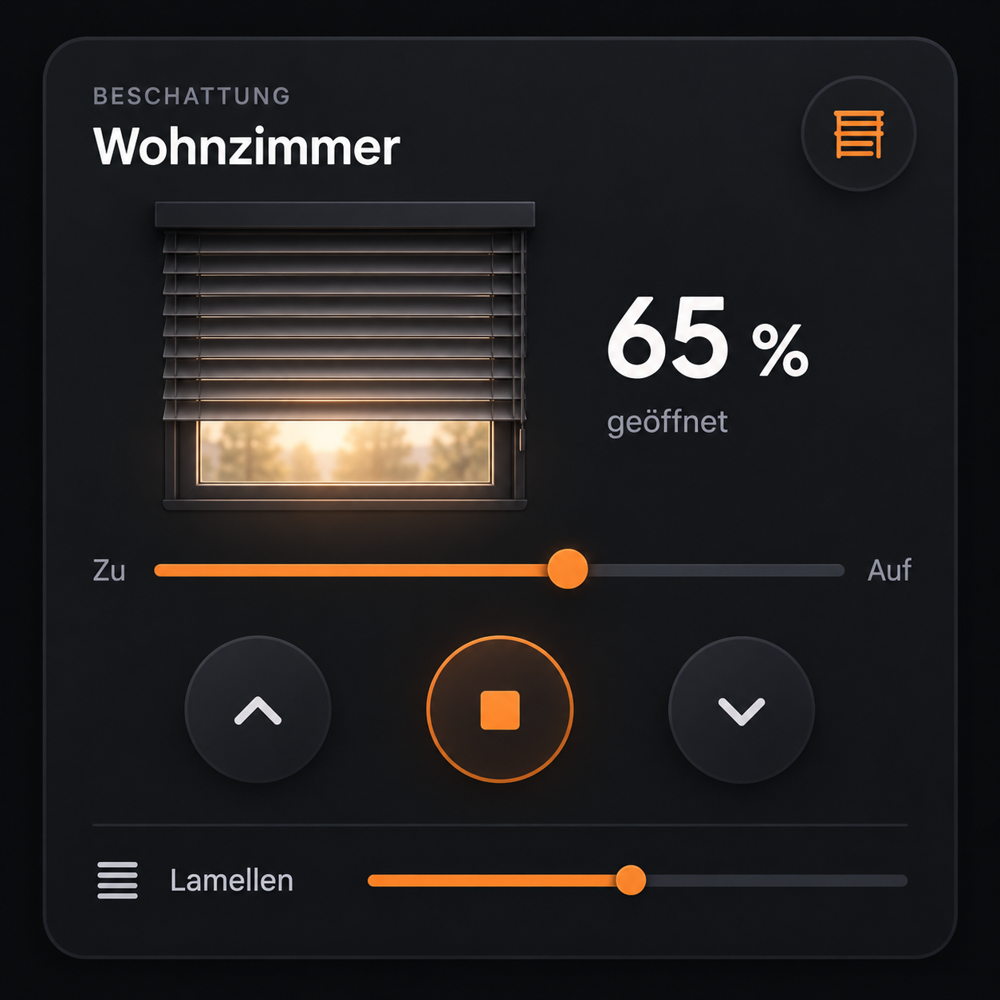
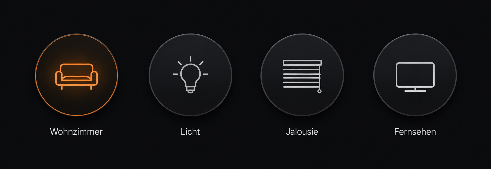

# Glass Cover Cards

Eine Sammlung responsiver Home-Assistant-Lovelace-Karten. Die Kartenquellen liegen getrennt unter `cards/<kartenname>/`; `npm run build` legt die HACS-Dateien gemeinsam in `dist/` ab.

## Entwicklung

```sh
npm run build
npm test
```

`cards/glass-cover-card/` und `cards/glass-button-card/` enthalten die jeweiligen Quellen. Die gebauten `dist/*.js`-Dateien werden mit versioniert, damit HACS sie direkt aus einer GitHub-Release installieren kann.

## Karten

### Glass Cover Card



Steuert eine Jalousie mit Positionsregler, Hoch/Stopp/Runter, optionaler Lamellenleiste und Schnellwahl.

```yaml
type: custom:glass-cover-card
entity: cover.wohnzimmer
name: Wohnzimmer
title: Beschattung
show_tilt: true
show_main_controls: true
show_close_tilt: true
show_preview: true
invert_position: false
button_size: 5
title_size: 5
preview_size: 5
# Optional: getrennte Entitaet fuer die Lamellenposition
# tilt_entity: cover.wohnzimmer_lamellen
```

### Glass Button Card



Zeigt mehrere runde Buttons nebeneinander. Pro Button sind Entitaet, Icon, Text und Aktion einstellbar. Die Icon-Auswahl enthaelt unter anderem Sofa, Licht, Jalousie und Fernseher.

```yaml
type: custom:glass-button-card
button_size: 5
columns: 4
show_name: true
buttons:
  - entity: light.wohnzimmer
    name: Wohnzimmer
    icon: mdi:sofa-outline
    action: toggle
  - entity: light.deckenlampe
    name: Licht
    icon: mdi:lightbulb-outline
    action: toggle
  - entity: cover.wohnzimmer
    name: Jalousie
    icon: mdi:blinds-horizontal
    action: toggle
  - entity: media_player.fernseher
    name: Fernsehen
    icon: mdi:television
    action: more-info
```

In Home Assistant kann die Liste im visuellen Karteneditor bearbeitet werden: Buttons hinzufuegen/entfernen, Entitaet auswaehlen, Icon aus der Liste waehlen, Text setzen und zwischen Ein-/Ausschalten und Mehr-Informationen waehlen.

## Installation ueber Marketplace / HACS

Das oeffentliche Repository heisst weiterhin `glass-cover-card`, damit HACS die gleichnamige Einstiegskarte erkennt. Die automatisch geladene `glass-cover-card.js` registriert beide Karten. Die aktuelle Repository-Version ist `v1.8.0`.

1. Oeffne in Home Assistant **Einstellungen > Marketplace** (ab Home Assistant 2026.11) beziehungsweise **HACS** (bis Home Assistant 2026.10).
2. Oeffne das Menue oben rechts und waehle **Benutzerdefinierte Repositories**.
3. Fuege `https://github.com/bimberle/glass-cover-card` hinzu und waehle den Typ **Dashboard**.
4. Suche nach **Glass Cover Cards**, oeffne den Eintrag und installiere ihn.
5. Lade die Dashboard-Ressource neu. Die Ressource `glass-cover-card.js` registriert sowohl `custom:glass-cover-card` als auch `custom:glass-button-card`.

  - Home Assistant 2026.11+: `/local/community/glass-cover-card/glass-cover-card.js`
  - Aeltere HACS-Versionen: `/hacsfiles/glass-cover-card.js`

Fuege danach im Dashboard-Editor eine benutzerdefinierte Karte mit `type: custom:glass-button-card` hinzu.

**Schon v1.7.0 installiert?** Aktualisiere auf v1.8.0 und lade die Repository-Dateien in Marketplace/HACS erneut herunter. Falls du vorerst bei v1.7.0 bleibst, musst du zusaetzlich die Button-Ressource registrieren: `/local/community/glass-cover-card/glass-button-card.js` (Home Assistant 2026.11+) oder `/hacsfiles/glass-button-card.js` (aelteres HACS). Beide Ressourcen muessen als **JavaScript-Modul** eingetragen sein.

## Manuelle Installation

Kopiere `glass-cover-card.js` aus `dist/` nach `/config/www/` und registriere `/local/glass-cover-card.js` unter **Einstellungen > Dashboards > Ressourcen** als **JavaScript-Modul**. Die Datei enthaelt beide Karten. Optional kann fuer eine isolierte Buttonkarten-Installation stattdessen nur `glass-button-card.js` kopiert und `/local/glass-button-card.js` registriert werden.

## Optionen

### Glass Button Card

| Option | Standard | Beschreibung |
| --- | --- | --- |
| `buttons` | `[]` | Liste der Buttons mit `entity`, optional `name`, `icon` und `action` |
| `button_size` | `5` | Groesse von `1` (ein Drittel) bis `5` (entspricht den grossen Jalousiebuttons) |
| `columns` | `4` | Maximale Buttons pro Reihe (1 bis 8); auf schmalen Displays wird automatisch auf 2 oder 1 Spalte gewechselt |
| `show_name` | `true` | Buttontexte ein- oder ausblenden |
| `action` | `toggle` | `toggle` schaltet die Entitaet; `more-info` oeffnet deren Detaildialog |

Pro Button kann `icon` auf ein MDI-Icon gesetzt werden, zum Beispiel `mdi:sofa-outline`, `mdi:lightbulb-outline`, `mdi:blinds-horizontal` oder `mdi:television`. Ist `name` leer, wird der Friendly Name der Entitaet verwendet.

### Glass Cover Card

| Option | Standard | Beschreibung |
| --- | --- | --- |
| `entity` | erforderlich | Cover-Entitaet fuer Fahrt und Position |
| `name` | Friendly Name | Name in der Kartenueberschrift |
| `title` | `Beschattung` | Kleine Ueberschrift oberhalb des Namens |
| `show_tilt` | `true` | Lamellen-Schieberegler anzeigen oder ausblenden |
| `show_main_controls` | `true` | Buttons Hoch, Stopp und Runter anzeigen oder ausblenden |
| `show_close_tilt` | `true` | Vierten Button fuer „100 % geschlossen und Lamellen 50 %“ anzeigen oder ausblenden |
| `show_preview` | `true` | Vorschaubild und Prozentwert anzeigen; Positionsslider bleibt sichtbar |
| `invert_position` | `false` | Slider-Richtung und Prozentbedeutung umkehren |
| `button_size` | `5` | Groesse der Steuerbuttons von `1` bis `5` |
| `title_size` | `5` | Groesse der Ueberschrift von `1` bis `5` |
| `preview_size` | `5` | Groesse von Jalousienbild und Prozentanzeige von `1` bis `5` |
| `tilt_entity` | `entity` | Optionale Cover-Entitaet fuer die Lamellenposition |

Die Cover-Integration muss die jeweiligen Home-Assistant-Dienste und Attribute unterstuetzen. Es gibt keine externen Build-Abhaengigkeiten; zum Erzeugen von `dist/` wird Node.js benoetigt.